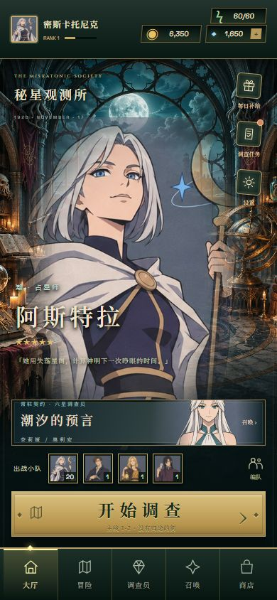
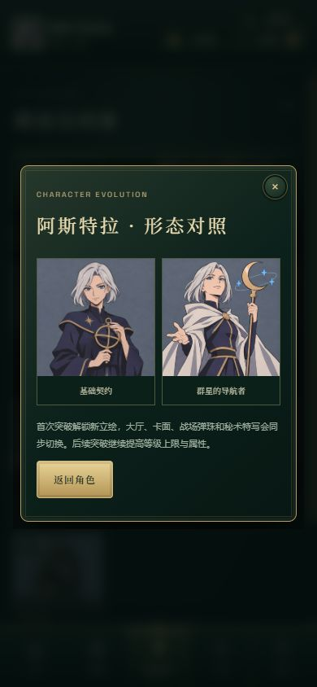

# 深渊弹珠 · 群星契约

原创克苏鲁主题单人弹射养成 RPG，支持手机竖屏触控、电脑鼠标与键盘。

**[在线试玩](https://StevenYang723.github.io/abyssal-ricochet/)** · [部署状态](https://github.com/StevenYang723/abyssal-ricochet/actions/workflows/pages.yml)

 

## 游戏内容

- **观星台大厅**：队长展示、出战小队、每日补给、任务奖励、资源栏与常驻召唤入口。
- **主线调查**：3 章共 9 关，每关 3 波敌人；逐关解锁、体力消耗、首通奖励、三星评价与重复刷取材料。
- **群星契约**：12 位原创调查员，每人拥有基础与突破两套立绘，单抽与十连、召唤动画、五星保证、六星保底、重复角色魂片、幸运值。
- **角色养成**：等级强化、四阶段觉醒、上限从 20 级提升至 100 级；攻击、生命、援护与秘术伤害随养成提升。首次突破解锁新立绘，后续突破提升等级上限与属性。
- **四人编队**：选择队长、交换位置、替换角色；每位角色保留自己的技能，反射与贯通拥有不同碰撞行为。
- **战斗表现**：命中停顿、闪白、镜头冲击、光核拖尾、连锁援护、伤害跳字、粒子碎片、击杀消散、大招特写与分层音效。
- **专属技能**：12 种友情援护、12 种秘术，涵盖狙击、汲取、护盾、净化、延迟陨星、毒伤、控制、穿甲与强化弹射；各自使用独立的图形、色彩和音效。
- **首领战术**：三位首领各有三种循环招式、范围预警和半血狂暴；激光、孢子、钟阵、触手、黑潮及安全区拥有对应表现。
- **免费演练**：在角色详情试放援护和秘术，或从首领情报演练招式；不消耗体力，也不会获得正式关卡奖励。
- **夜行商会**：用游戏资源兑换体力、残响和古印；任务、每日补给和通关组成资源循环。
- **本地存档**：自动保存、导出与导入 JSON，支持存档结构校验与损坏恢复。

当前版本是完整的单机循环。没有后端账号、联网联机、付费功能或跨设备自动同步。游戏资源只用于游戏内玩法；换设备时可在设置中导出、导入存档。刷新或退出未结束的战斗会放弃该次调查，体力不返还。

## 召唤与资源规则

- 单次消耗 300 星晶，十连消耗 2,700 星晶。
- 基础概率：四星 72%、五星 24%、六星 4%，同稀有度角色等概率。
- 十连至少一位五星及以上；连续 29 次未获得六星，第 30 次必得六星。六星保底优先，两种召唤共享保底计数。
- 重复四、五、六星分别获得 20、40、80 魂片，并增加 5 幸运。20 魂片可换 30 残响。
- 队长幸运每增加 1 点（初始 1）增加 1% 通关金币，上限 99 幸运。
- 体力每 5 分钟恢复 1 点，上限 60。每日补给按设备本地日期重置。
- 通关获得一星；剩余生命至少 50% 再获一星；16 次以内弹射完成再获一星。已取得的最高星级不会被重刷覆盖。

## 战斗操作

按住发光的调查员，向目标相反方向拖动，松手弹射。碰触队友触发友情援护，每位同伴每次弹射触发一次。反射型撞击敌人反弹，贯通型穿越敌人；墙壁和障碍会反弹所有角色。

秘术充能达到 100% 后点击当前角色的秘术按钮，下一次弹射发动对应技能。每位角色效果不同，可在角色详情查看说明。首领头顶数字为招式倒计时，顶部显示下一招名称和规避方法；危险区域会提前锁定，部分技能会留下持续区域。护盾吸收伤害，毒伤与灼烧在弹射结束后结算。敌人头顶数字为反击倒计时，生命或理智归零则调查失败。右上角可以暂停和切换音效。

键盘：点击战场后，左右键调整角度，上下键重置方向，空格发射，R 切换秘术。

## 本地运行与部署

无需安装 npm 依赖。运行 `node preview.cjs` 后打开 `http://127.0.0.1:4173`。也可以把 `dist/` 部署到任意静态网站服务。

推送到 `main` 后，`.github/workflows/pages.yml` 会检查 JavaScript，运行战斗和养成验证，并将 `dist/` 自动发布至 GitHub Pages。

## 代码结构与验证

| 文件 | 用途 |
| --- | --- |
| `dist/engine.js` | 固定步长物理、碰撞、友情援护、多波战斗 |
| `dist/game.js` | 战斗操作、状态与弹窗 |
| `dist/battle-fx.js` | 战斗美术渲染、命中停顿和特效 |
| `dist/progression.js` | 角色目录、关卡、存档、召唤、养成和经济逻辑 |
| `dist/campaign.js` | 大厅、选关、召唤、图鉴、商店与战斗衔接 |
| `dist/combat-kit.js` | 12 套角色技能、首领招式、状态与预警判定 |
| `dist/ability-fx.js` | 角色专属特效、首领施法与预警渲染 |
| `dist/campaign-extras.js` | 形态对照、首领情报和免费演练 |
| `dist/tactics.css` | 立绘与技能展示、战术提示和演练布局 |
| `dist/campaign.css` | 游戏大厅及养成界面的响应式样式 |

运行 `node test-engine.cjs`、`node test-progression.cjs` 和 `node test-tactics.cjs`。

验证覆盖反弹、贯通、伤害、换位援护、治疗、秘术、失败、全部 9 关实际物理通关、解锁、体力恢复、奖励幂等、抽卡保底、重复转换、编队唯一性、养成消耗、任务、商店、存档恢复与异常存储。新增验证覆盖 12 套技能、护盾吸收、净化、延迟结算、穿甲、首领招式轮换、半血狂暴、预警区域、安全区、毒伤收尾及突破立绘存档恢复。v3 存档保持兼容。

美术使用内置 ImageGen 生成，提示词及最终素材路径见 `art-direction.txt`。字体提供本地回退；减少动态效果遵循系统偏好。
